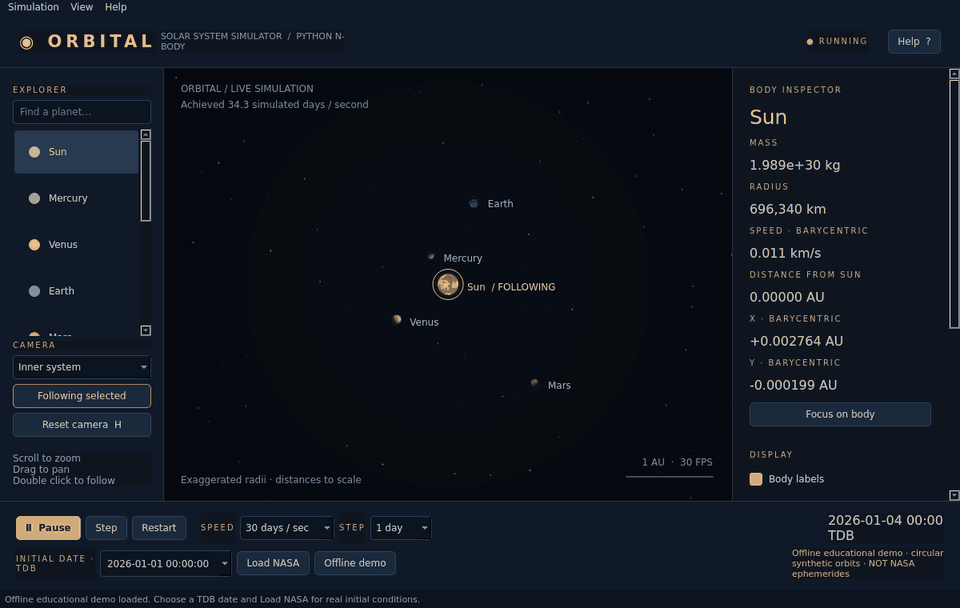

# Solar System Simulator 2

Explore the solar system in a Python desktop app. It uses N-body gravity, leapfrog integration, NASA Horizons data, and GPU graphics.



*The demo shows simulated motion using the offline sample, not NASA starting data.*

## Run

You need Python 3.10+ and a graphics driver with OpenGL 3.3 support.

```bash
python3 -m venv .venv
source .venv/bin/activate
python -m pip install -e .
solar-system
```

On Windows, activate the environment with `.venv\Scripts\activate` instead. You can also download the `.exe` from [Releases](https://github.com/Aamir2020/solar-system-simulator-2/releases) when a release is available.

The app starts paused with an offline sample. Press **Play** to begin. For NASA starting data, choose a date and press **Load NASA**. Dates use **TDB**, the time scale used by the simulation, rather than your local time.

## Controls

- Scroll to zoom. Drag to pan.
- Click a planet to select it. Press **Play** to follow it.
- Select another planet while playing to follow that planet.
- Double click a planet to focus on it.
- Use the side panels to change the view, labels, trails, and planet sizes.
- Press **Space** to pause, **H** to reset the camera, and **F1** for help.
- Press **Ctrl+S** to save a screenshot.

Planet sizes are enlarged by default. The simulation is 2D and does not include moons, collisions, or relativity. NASA provides the starting positions and velocities; Python calculates the motion after that.

## Tests

```bash
python -m pip install -e '.[dev]'
python -m unittest discover -s tests -v
```

## Windows releases

Push a tag to build a Windows `.exe` and publish it on GitHub Releases:

```bash
git tag -a v2.0.1 -m "Release v2.0.1"
git push origin v2.0.1
```

## Credits

Code by Aamir Zekaria Ali, under the [MIT license](LICENSE). Starting data comes from [NASA/JPL Horizons](https://ssd-api.jpl.nasa.gov/doc/horizons.html). Planet maps are by Solar System Scope / INOVE, under [CC BY 4.0](https://creativecommons.org/licenses/by/4.0/). See [texture credits](src/solar_system_simulator/assets/textures/ATTRIBUTION.md).
