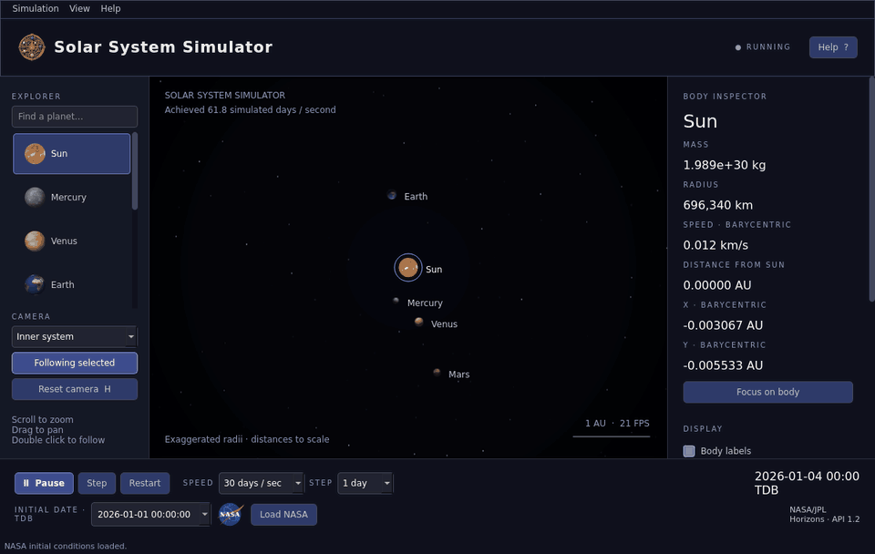

# Solar System Simulator

Explore the solar system in a Python desktop app. It uses N-body gravity, leapfrog integration, NASA Horizons data, and GPU graphics.



*The demo uses initial positions and velocities loaded from NASA Horizons.*

## Install on Windows

1. Open the [latest release](https://github.com/Aamir2020/solar-system-simulator-2/releases/latest).
2. Under **Assets**, download `Solar-System-Simulator-windows-x64.exe`.
3. Open the downloaded file to start the app. You do not need to install Python.

You need 64-bit Windows and a graphics driver with OpenGL 3.3 support.

Choose a date and press **Load NASA**, then press **Play**. The app stays empty until data is loaded. Exact-date NASA responses are cached for later use; there is no bundled sample or synthetic fallback. Dates use **TDB**, the time scale used by the simulation, rather than your local time.

## Run from source

You need Python 3.10+ and a graphics driver with OpenGL 3.3 support.

```bash
python3 -m venv .venv
source .venv/bin/activate
python -m pip install -e .
solar-system
```

On Windows, activate the environment with `.venv\Scripts\activate` instead.

## Controls

- Scroll to zoom. Drag to pan.
- Click a planet to select it. Press **Play** to follow it.
- Select another planet while playing to follow that planet.
- Double click a planet to focus on it.
- Use the side panels to change the view, labels, trails, and planet sizes.
- Press **Space** to pause, **H** to reset the camera, and **F1** for help.
- Press **Ctrl+S** to save a screenshot.

Planet sizes are enlarged by default. The simulation is 2D and does not include moons, collisions, or relativity. NASA provides the starting positions and velocities; Python calculates the motion after that.

## Tests

```bash
python -m pip install -e '.[dev]'
python -m unittest discover -s tests -v
```

## Credits

Code by Aamir Zekaria Ali, under the [MIT license](LICENSE). 

Starting data comes from [NASA/JPL Horizons](https://ssd-api.jpl.nasa.gov/doc/horizons.html). 

Planet maps are by Solar System Scope / INOVE, under [CC BY 4.0](https://creativecommons.org/licenses/by/4.0/). 

See [texture credits](src/solar_system_simulator/assets/textures/ATTRIBUTION.md).
